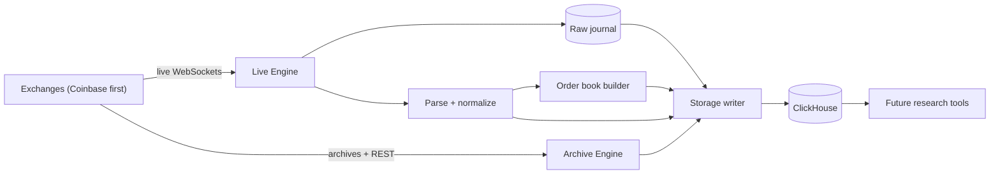

# JetStream

**Yet another C++ CEX tick engine for crypto markets**
---

## TL;DR

JetStream is a market-data recorder. It connects to crypto exchanges (Coinbase first, then Binance and OKX depending on legal sign-off), records every trade, top-of-book quote and order-book update in real time, backfills as many years of history as we can get for free, and stores all of it in a ClickHouse database so the investment team has real, research-grade data to work with.

**Note: order-book (L2) history basically isn't free.** Exchanges will hand you years of trade history through bulk archives, but the full order book you have to record yourself, live. Every day the recorder isn't running is a day of L2 data the club will never get back. So the whole plan is built around one goal first: **get a recorder running 24/7 before winter break (Dec 18)**, then spend the rest of the year making it better.

---

## Why we're building this

Right now, if someone on the FranklinDAO Investment Team wants to study order flow, spreads, liquidity or anything microstructure-related, the options are pretty much "pay a data vendor" or "settle for candles." JetStream gives the club its own dataset that keeps growing every day it runs, and that we actually understand end to end (what's in it, what's missing, and why).

It's also very much a learning project. A big part of the point is to get genuinely good at high-performance C++: networking, concurrency, parsing, storage engineering, the works. We have an engineering mentor guiding the build, and the plan is structured so that each phase teaches one core concept. The timeline is roughly nine months, **Nov 2026 to Aug 2027**, and by the end the goal is for the people working on it to be able to design and build a system like this on their own.

---

## What JetStream does

It has three jobs:

1. **Live capture.** Keep long-running TLS WebSocket connections open to each exchange and record trades, best bid/offer (BBO) and full L2 order-book updates as they happen.
2. **Historical backfill.** In parallel, pull as much history as is legally and freely available (up to ~8 years where it exists) from bulk archive files and paginated REST APIs. Raw trades where possible, otherwise candles.
3. **Storage.** Parse, normalize and store everything in a local ClickHouse database that's ready for quant research down the line.

### The data

"Trade data from the order book" is actually a few different things, and mixing them up is one of the most common sources of silent bugs in market-data systems. Here's what we're dealing with:

| Data type | What it is | Can we get it later? | Priority |
|---|---|---|---|
| **Trades** | Individual executions (fills), each with a venue trade ID | Mostly yes (archives, REST) | Live from day one + backfill |
| **BBO / top of book** | Best bid and ask, price and size | Partly | Live, and also derived from our own book |
| **L2 diffs** | Changes to the total size resting at a price level | **Mostly no** | **Highest. Live from day one.** |
| **L2 snapshots** | Full (or top-N) book state at a point in time | Only if we recorded it | Every resync + periodically |
| **Candles (OHLCV)** | Open/high/low/close/volume per interval | Yes | Backfill, and derived live from trades |

That "mostly no" in the L2 row is the reason the recorder ships first. We couldn't find any free L2 history for Coinbase, Binance doesn't document any, and OKX only has L2 files going back to March 2023.

### What we're *not* doing (at least not now)

To keep scope sane, these are explicitly out:

- **No trading, order entry or account data.** Everything is public market data.
- **No UI or dashboard for research.** JetStream ends at well-documented ClickHouse tables and views. A research app can plug into those later.
- **No L3 / order-by-order feeds.** Those require authenticated credentials.
- **No nanosecond latency race.** No kernel bypass, FPGAs or colocation. Our data comes over the public internet, where round trips are measured in milliseconds, so shaving microseconds off the hot path doesn't buy us anything meaningful.
- **No redistributing raw exchange data** outside the club.
- **No getting around rate limits or geo-blocks.** More on that below.

---

## Rate limits and legal


**Rate limits.** Public market data doesn't need an account, and every venue limits it per IP. So the rules are:

- One IP per recorder, and we pace ourselves at **≤80% of every published limit**, driven by the rate-limit headers the servers send back.
- **No rotating accounts or IPs** to get more throughput. It's prohibited by the terms, and the enforcement is automatic and escalating (Binance's IP bans go from 2 minutes up to 3 days for repeat offenders). An IP ban during a volatile week means L2 data we can never recover.
- Running a second machine for **redundancy** is good engineering. Running a second machine to **exceed limits** is evasion. We do the first, never the second.
- A 451 (geo-block) response is a hard stop. The venue gets disabled automatically and we escalate. **We never VPN around it.**

**Data sharing.** Recorded data stays inside the club. If anyone ever wants to use it for something commercial (a startup, say), talk to me first, because several of the source licenses exclude commercial use.

---

## How we're approaching it

### Design principles

These show up everywhere in the codebase, so they're worth knowing:

1. **Raw first, normalize second.** Every message we receive gets saved exactly as it arrived, with a receive timestamp, *before* we parse it. The normalized tables are just a projection we can re-run. That means a rough recorder in December still produces valuable data, because we can re-parse December's raw frames with March's (much better) parser.
2. **Every gap is data.** Disconnects, sequence breaks and dropped messages all get recorded as rows in an audit table. A dataset with known, documented holes is research-grade. A dataset with unknown holes isn't.
3. **Share nothing on the hot path.** Each thread owns its connections and order books outright. Threads only talk through lock-free single-producer/single-consumer ring buffers. No locks and no memory allocation in steady state.
4. **The network never waits on storage.** If ClickHouse hiccups, the data gets absorbed by buffers, retries and spill-to-disk files. A stalled socket misses keepalive pings, gets disconnected and loses L2.
5. **Crash-only.** Any part of the system can be killed at any moment. Restarting just means reconnect, resync the books from a fresh snapshot and resume backfills from their checkpoints.
6. **Venues are config, not code.** Endpoints, limits, keepalive timings and subscriptions all live in a TOML config file. (In 2026 alone, Binance and OKX each changed URLs in ways that would've broken a hard-coded recorder.)
7. **Compliance by construction.** The venue allowlist, the 80% budgets and the absence of any multi-IP logic are enforced by tests, not just good intentions.

### Architecture at a glance

JetStream runs as a single process (`jetstreamd`) alongside a ClickHouse server on one Linux box. Inside the process there are two independent subsystems: the **Live Engine** (WebSocket connections, parsing, order books) and the **Archive Engine** (bulk downloads and REST backfill). They share the event model and the storage writer, and nothing else.



On the threading side, the short version is:

- **Feed threads** each run their own event loop and own a fixed set of connections. Each one does TLS, WebSocket deframing, raw capture, parsing, sequence checking and order-book updates for its connections, with no locks.
- Feed threads hand events off through **lock-free ring buffers** (one for normalized events, one for raw bytes).
- A **batcher thread** collects events into large columnar blocks per table, and **one writer thread per table** inserts them into ClickHouse in batches of roughly 10k–100k rows about once a second (which is what ClickHouse recommends).
- A **journal thread** writes the raw frames to compressed files on disk.

---

## Tech stack

| Area | Choice | Why |
|---|---|---|
| Language | **C++20** (GCC 16 + Clang in CI) | GCC 16 makes C++20 the default; coroutines make async networking way more readable |
| Build / packages | **CMake** with presets, **vcpkg** (pinned baseline) | Reproducible builds, binary caching in CI |
| Networking | **Boost 1.92 Asio + Beast**, C++20 coroutines | Best-maintained option for lots of outbound TLS WebSocket clients |
| TLS | **OpenSSL 3.x (≥3.1, not 3.0.x)** | 3.0.x has known performance problems |
| JSON parsing | **simdjson** (On-Demand API) | SIMD-accelerated, reuses its buffers, zero allocation in steady state |
| Prices & sizes | **Hand-written fixed-point parser** (scaled 64-bit integers) | Prices never go through `double`, so no floating-point rounding errors |
| Thread hand-off | **Hand-written SPSC ring buffers** | One producer, one consumer per edge, so no contention to pay for |
| Logging | **Quill** | Formats on a background thread, very low overhead on the hot path |
| Metrics | **OpenTelemetry** + Prometheus endpoint, **HdrHistogram** for latency | Standard tooling, proper tail-latency measurement |
| Database | **ClickHouse 26.8 LTS** (single node), via **clickhouse-cpp** over the native protocol | Columnar, compresses tick data really well, LTS supported through Aug 2027 |
| Testing | GoogleTest, Google Benchmark, libFuzzer, ASan/UBSan/TSan | Unit, property, fuzz and race testing |
| Deployment | **Docker Compose** on one Linux host (systemd as a backup option) | Simple, reproducible, restarts on crash |
| CI | **GitHub Actions** (GCC + Clang matrix) | Every PR built and tested under every sanitizer preset |

Prices and quantities are stored as `Decimal64(8)` in ClickHouse and as a matching `Fixed<8>` type in C++. That's exact to 8 decimal places, and anything that doesn't fit gets refused at subscription time instead of silently truncated.

---

## Modules

The codebase is split into 18 modules. Dependencies only point "downward," and each exchange adapter depends on shared modules but never on another adapter, which is what makes it possible for several people to work in parallel.

### Live engine

| Module | What it does |
|---|---|
| **M05 net** | The TLS WebSocket transport. Turns an endpoint into a stream of timestamped frames. Knows nothing about any specific exchange. |
| **M08 venues** | One adapter per exchange (Coinbase, Binance, OKX) behind a common `IVenueAdapter` interface. All the venue-specific weirdness lives here. |
| **M07 parse** | Fast JSON parsing (simdjson) plus hand-written parsers for decimals and ISO-8601 timestamps. |
| **M09 normalize** | Defines the canonical event format so data from three venues is actually comparable (e.g. symbols are always `BTC-USD` or `BTC-USDT-PERP`, and trade side is always the *aggressor* side). |
| **M10 seq** | Sequence and gap detection, encoding each venue's own continuity rules. Small, but probably the most important correctness code in the project. |
| **M11 book** | The L2 order-book engine. We build it three times: a simple `std::map` version that becomes the permanent test oracle, a fast cache-friendly flat-vector version for production, and maybe a price-indexed array if profiling justifies it. |
| **M12 capture** | The raw journal (every frame, compressed, on disk) and the replay tool that re-runs recorded data through the whole pipeline. This is what makes the December recorder worth running. |

### Storage

| Module | What it does |
|---|---|
| **M13 handoff** | The lock-free SPSC ring buffers. The only cross-thread communication on the data path. |
| **M14 storage** | Batches events per table, does idempotent inserts with deduplication tokens (so retries never create duplicates), and spills to local disk if ClickHouse is down. |

### Archive (historical backfill)

| Module | What it does |
|---|---|
| **M06 rest** | An HTTPS client with a token-bucket rate limiter that physically can't exceed venue budgets. Reacts properly to 429s, auto-bans (418) and geo-blocks (451). |
| **M15 archive** | Bulk downloader with SHA-256 checksum verification, a REST pager that checkpoints after every page (so a crash loses at most one page), and a completeness verifier that proves we have every trade ID in a range. |

### Plumbing and infrastructure

| Module | What it does |
|---|---|
| **M01 core** | Shared vocabulary types: venues, sides, instrument IDs, the `Fixed<8>` decimal type. |
| **M02 clock** | Reads clocks and converts exchange timestamps between ms, µs and ns. |
| **M03 config** | Loads and validates the TOML config, enforces the venue allowlist, and lints for known-retired endpoints. |
| **M04 obs** | Logging, metrics and latency histograms. Logs events (connects, gaps, errors), **never** one line per message. |
| **M16 control** | The supervisor. Starts threads, runs each connection's state machine, handles planned reconnects, and serves `/health`, `/ready` and `/metrics`. |
| **M17 testkit** | A mock exchange server that can simulate pretty much every failure (missed pings, dropped connections, sequence gaps, shutdown notices), plus fuzzers and recorded test data. |
| **M18 deploy** | Docker setup, ClickHouse configuration, backups and runbooks. Success criterion: someone who isn't me can bring up a recorder from scratch using only the README. |

### Stuff for later

Once the core is solid, the backlog includes more exchanges (Kraken, Bybit, etc.), perpetuals data (funding rates, mark price, liquidations), tiered hot/cold storage, more pre-computed views (VWAP, spread and depth metrics), a query API for the future research app, and alerting.

---

## Data model

Everything lands in a ClickHouse database called `jetstream`. The main tables:

| Table | Contents |
|---|---|
| `trades` | Every execution: venue, symbol, exchange time, receive time, trade ID, price, size, aggressor side, source (live / REST / archive) |
| `bbo` | Best bid/offer updates |
| `l2_updates` | Every order-book level change (absolute size; 0 means the level was deleted) |
| `book_snapshots` | Top-N book state on every resync and periodically |
| `candles` | OHLCV bars from backfill |
| `raw_messages` | The raw frames, mirrored from the journal for ad-hoc queries |
| `gap_audit` | Every gap, disconnect or dropped message, with exact start/end times and whether it was repaired |
| `ingest_sessions` | Connection lifecycle history |
| `backfill_jobs` | Progress and checkpoints for every historical download job |
| `instruments` | Reference data: tick sizes, lot sizes, canonical symbols |
| `ohlcv_1m` | 1-minute bars, maintained automatically from `trades` |

For research, the plan is to query **stable read views** (`v_trades`, `v_bbo`, `v_l2_updates`, `v_book_snapshots`, `v_ohlcv_1m`) with a read-only user, so the underlying tables can change without breaking anyone's queries. Every event also carries **two timestamps**: the exchange's event time and our local receive time. Fair warning for anyone doing latency analysis: our clock is accurate to roughly the millisecond (synced with chrony against public NTP), so don't read too much into sub-millisecond differences.

Rough sizing: trades compress to under ~10 bytes per row, so years of trade history is cheap. Live L2 is what eats disk, plausibly 0.5–2 TB per year for about 10 pairs across 3 venues. We'll replace those estimates with real measurements from a pilot run in Week 0.

---

## Roadmap

Just some rough timeline thoughts for now.

| Phase | Dates | Focus | Milestone |
|---|---|---|---|
| **P0** | Nov 16–27 | Toolchain, repo, CI, Week-0 verification spikes, legal inquiry sent | CI green on all presets |
| **P1** | Nov 30–Dec 18 | Sockets, TLS and WebSockets from first principles; walking skeleton | **Dec 11:** Coinbase trades flowing end to end into ClickHouse. **Dec 18: L2 recorder live 24/7.** |
| *Break* | Dec 19–Jan 3 | Recorder runs unattended; reading only | |
| **P2** | Jan 4–29 | Parsing, canonical model, fixed-point; replay tool | December's raw data re-parsed cleanly |
| **P3** | Feb 1–26 | Concurrency, memory model, lock-free rings | Threaded pipeline, race-free under TSan |
| **P4** | Feb 22–Mar 26 | ClickHouse storage engineering, dedup, retries, spill | Survive a 10-min ClickHouse outage with zero loss and zero duplicates |
| **P5** | Mar 22–Apr 30 | Order books, sequencing, gap recovery | Verified Coinbase books + trade-gap repair |
| **P6** | Apr 26–Jun 4 | More venues (per the legal decision), resilience, zero-gap reconnects | 2nd and 3rd venues live |
| **P7** | May 24–Jul 9 | Archive engine and rate-limit engineering | Backfill complete + completeness report |
| **P8** | Jul 5–30 | Performance engineering and profiling | Performance report (flame graphs, latency histograms) |
| **P9** | Jul 26–Aug 20 | Hardening, ops, handover | Another member deploys it from scratch |

The dates during term assume part-time work alongside classes. We'll recalibrate after P1 based on actual pace, and finals and breaks are treated as reduced capacity. The recorder is designed to keep running through all of it.

---

## Collaboration


- **Design doc or ADR before code.** Every module starts with a one-to-two-page design doc or an Architecture Decision Record (context, decision, alternatives rejected, consequences). Writing it forces you to actually think the design through.
- **Spike, then build.** If there's an open question ("does Beast auto-reply to pings?"), we answer it with a small, time-boxed experiment first.
- **Small PRs, review as teaching.** For hot-path code, the author walks the reviewer through it out loud ("explain-back"). If you can't explain a line, it doesn't merge.
- **Benchmark before optimizing.** No performance PR merges without before/after numbers and an explanation of *why* it got faster.
- **Friday demos.** 30 minutes, show something running (a query, a graph, a failure being handled).
- **Blameless postmortems** for any unrecoverable L2 gap, rate-limit ban or data loss.

---

## How to get involved

The work is split into parallel lanes with frozen interfaces between them, so people can contribute without stepping on each other. Some lanes open up later than others:

| Lane | What's in it | Opens |
|---|---|---|
| **Transport & capture** | WebSocket client, raw journal, Coinbase connection | Week 1 (this is the critical path until Dec 18) |
| **Parsing & venues** | Message parsing, normalization, Binance/OKX adapters (offline against docs) | After the recorder is live |
| **Concurrency & storage** | Ring buffers, batcher, ClickHouse writers | Ring buffer kata any time; storage from ~week 2 |
| **Order books** | Sequencing rules, book engine, validation | After the event model is defined (late Jan) |
| **Archive / backfill** | Rate limiter, REST pager, archive loaders | Rate limiter any time; the rest after storage lands |
| **Testing & quality** | Mock exchange server, chaos tests, fuzzing, nightly data-quality SQL | After the WebSocket client exists |
| **Ops & observability** | Dashboards, alerts, backups, runbooks, host setup | Once we have hardware |

**You don't need to be a C++ person to help.** Some really useful contributions:

- Writing the **first research queries** against the data (this actually shapes the table design in P4).
- Helping decide the **instrument universe** beyond BTC and ETH.
- Dashboards, runbooks and the data dictionary.
- Reading exchange docs and terms carefully (seriously, this project lives and dies by the fine print).

---

## Open questions

| Question | Who decides | Needed by |
|---|---|---|
| Which venues are approved after legal review? Can we use the Binance archives? | Club leadership + Penn OGC | Late April 2027 at the latest, ideally much sooner |
| **Where does the production server live, and who pays for it?** | Club leadership | **Before Dec 18, 2026** |
| Which instruments beyond BTC and ETH, and at what book depth? | Investment team | ~April 2027 |
| How long do we keep raw messages? (Drives disk cost.) | Me + mentor | P4 |
| Do we want perpetuals under the low-risk option, where only Coinbase US derivatives are available? | Investment team | P6 |
| Should we buy vendor history (e.g. Tardis academic, CoinAPI) for the global venues? | Club leadership | P7 |
| Who maintains JetStream after Aug 2027? | Club leadership | P9 |

The server question is the urgent one. The hardware recommendation is roughly 8–16 cores, 64 GB RAM, 4 TB NVMe, a big HDD for cold storage, an off-box backup bucket, a UPS and a wired connection, either in Philadelphia or in a US-East cloud region.

---

## Fun facts from the exchange docs

A few things the research turned up that would've broken a naive implementation (and are a good reminder to always read the changelogs):

- OKX retired its old WebSocket port 8443 for public internet connections on **Oct 31, 2026**. Older tutorials and libraries still use it.
- OKX's order-book checksum field has returned **0 since June 2026**. Integrity now relies on sequence IDs.
- Coinbase's Exchange `level2` channel has required authentication **since July 2023**. The free unbatched L2 feed is the Advanced Trade one.
- Coinbase reports the *maker* side on trades, so we flip it to get the aggressor side.
- Binance spot now pings every **20 seconds** (it used to be 3 minutes), and you have a minute to pong back.
- Binance's archive files switched from millisecond to microsecond timestamps on **Jan 1, 2025**, mid-dataset.

---

## Repo layout (planned)

```
jetstream/
  cmake/  CMakePresets.json  vcpkg.json
  src/
    core/  clock/  config/  obs/  net/  rest/  parse/
    normalize/  seq/  book/  capture/  handoff/  storage/
    venues/{coinbase,binance,okx}/  archive/  control/  app/
  sql/migrations/
  testkit/{mock_exchange,replay,fuzz,corpora}/
  bench/
  docs/{adr,design,spikes,postmortems,journal}/
  deploy/{docker,systemd,clickhouse}/
```

## Getting started

Not much to run yet. The build setup lands in P0. The plan is:

- A **Docker dev container** that pins the compiler and vcpkg baseline, so everyone builds the same thing.
- A **local ClickHouse 26.8** container for development.
- CMake presets: `release`, `debug-asan-ubsan`, `debug-tsan` and `relwithdebinfo-perf`.

So roughly (subject to change once P0 is done):

```bash
cmake --preset debug-asan-ubsan
cmake --build --preset debug-asan-ubsan
```

This section will get filled in properly once there's code to build.

---

## FAQ

**Why C++ and not Python?**
Partly because learning high-performance C++ is an explicit goal of the project. But also, a recorder that runs 24/7 across multiple venues benefits a lot from zero-allocation parsing, predictable memory use and exact fixed-point math. To be honest though, raw speed isn't the main challenge here. The network adds milliseconds while our hot path is in the microseconds. The hard parts are correctness, gap recovery and not losing data.

**Why not just buy the data?**
We might buy some! Vendor history for the global venues is one of the options on the table. But L2 history is expensive, vendor licenses restrict sharing, and having our own live recorder means the dataset keeps growing for free.

**Why ClickHouse?**
It's a columnar database that's really good at exactly this kind of data. ClickHouse's own Binance example compressed ~373 million trades into about 2 GB. A single node is plenty for us, and the 26.8 LTS release is supported for the whole project timeline.

**Can I use the data for my own project or startup?**
For club research, yes. For anything commercial, ask first. Several of our data sources are licensed for non-commercial academic use only.